<div align="center">
  <!-- Custom Native Animated Neon Header Banner -->
  
  <a href="https://github.com/Asifkarim683">
    
  </a>
  <p align="center">
    <a href="mailto:asifkarim683@gmail.com"></a>
    &nbsp;
    <a href="https://linkedin.com/in/asif-karim-a1b100349"></a>
    &nbsp;
    <a href="https://ieeexplore.ieee.org/document/11448757"></a>
    &nbsp;
    <a href="https://drive.google.com/drive/folders/1PObzilRz2YIutB7J6mgMuFSFgKsYQCJG"></a>
    &nbsp;
    <a href="https://github.com/Asifkarim683?tab=repositories"></a>
  </p>
</div>

---

### 💫 About Me

```yaml
developer:
  name: Asif Karim
  title: Web Development and AI Engineer
  summary: >
    Passionate engineer bridging full-stack web development with applied AI, autonomous agents & deep learning.
    Experienced in building full-stack platforms (React, Spring Boot, FastAPI),
    autonomous LangGraph agents, and publishing peer-reviewed deep learning research.
  key_highlights:
    - Experience: Software Engineering Trainee at Skill Revelation India (Nov 2025 - Apr 2026, 5 mos)
    - Research: Published IEEE Xplore Author in Computer Vision & Deep Learning (2025)
    - Major Project: Two-Stage Diabetic Retinopathy Detection & Severity AI (98.09% Acc, 0.9988 AUC)
    - Autonomous AI: LangGraph Agents, Local Private LLMs (Ollama), & Source-Grounded Multilingual RAG
    - Hackathons: Team Lead & UI Designer across Odoo, IIT, and Gen-AI (5 working prototypes)
    - Certifications: Anthropic AI Certified (20 Courses) | Fullstack Java (Centurion Univ)
```

- 🔬 **Published Researcher**: Author of *Canine Sentiment Analysis Using Deep Learning* published on [IEEE Xplore](https://ieeexplore.ieee.org/document/11448757) (2025).
- 👁️ **Clinical Healthcare AI**: Built an end-to-end **Two-Stage Diabetic Retinopathy Diagnostic System** with PyTorch, Grad-CAM attention heatmaps, and Gemini multimodal report generation ([Repository](https://github.com/Asifkarim683/Diabetic-Retinopathy-detection-using-deep-learning)).
- 🤖 **Agentic & RAG Systems**: Engineered autonomous multi-agent state machines with **LangGraph**, local voice AI operating environments with **Ollama + Three.js**, and safety-guarded medical RAG assistants across 6 Indian languages.
- 💼 **Professional Experience**: Software Engineering Trainee at **Skill Revelation India** (Nov 2025 – Apr 2026, 5 months), building structured ERP modules in PHP with responsive, mobile-friendly pages from design through deployment.
- 🏆 **Hackathon Leadership**: Participated as **Team Lead and UI Designer**, engineering 5 working prototypes across **Odoo, IIT, and Gen-AI** hackathons.
- ⚡ **Performance & UX Focus**: Track record of optimizing web application load times by 30% and implementing responsive layouts across 10+ production projects.

---

### 🛠️ Tech Stack & Arsenal

<div align="center">

  <p><b>Core Languages, Frameworks &amp; Tools</b></p>
  <a href="https://skillicons.dev">
    
  </a>

  <br/><br/>

| Domain | Technologies & Skills |
| :--- | :--- |
| **Languages** | `Python` `Java` `JavaScript` `TypeScript` `SQL` `PHP` `HTML` `CSS` `C++` |
| **Web & Backend** | `React` `Spring Boot` `FastAPI` `Laravel` `REST APIs` `JWT Authentication` `Tailwind CSS` `tRPC` `Node.js` |
| **AI & Machine Learning** | `PyTorch` `LangChain` `LangGraph` `RAG` `LLMs` `Ollama` `Google Gemini` `Computer Vision` `Deep Learning` `Prompt Engineering` |
| **Databases & Tools** | `PostgreSQL` `MySQL` `SQLite` `Docker` `GitHub Actions` `Git` `GitHub` `Postman` `VS Code` `Linux` |

</div>

---

### 💼 Professional Experience & Background

<div align="center">

| Role & Organization | Timeline | Key Focus & Impact |
| :--- | :--- | :--- |
| **Software Engineering Trainee** <br/>*Skill Revelation India* | **Nov 2025 – Apr 2026** <br/>*(5 months)* | • Built structured ERP modules in PHP with responsive, mobile-friendly pages from design through deployment.<br/>• Optimized asset delivery and query execution, achieving a **30% reduction in page load times**.<br/>• Implemented responsive UI components across **10+ web projects**, boosting mobile engagement. |
| **Hackathon Team Lead & UI Designer** <br/>*Odoo, IIT, Gen-AI* | **2024 – 2026** | • Led multidisciplinary teams and designed user-focused interfaces for **5 working prototypes**.<br/>• Achieved top-three podium finishes solving enterprise workflow and generative AI challenges. |

</div>

---

### 🤖 1. Autonomous AI & Agentic Systems

<table>
  <tr>
    <td width="50%" valign="top">
      <h3 align="center"><b>💸 Recoverly.ai (Payment Recovery Agent)</b></h3>
      <p align="center">
        <a href="https://payment-recovery-agent-three.vercel.app"></a>
        
        
        
      </p>
      <p>Autonomous AI agent system designed to detect failed transactions, classify root causes via smart heuristics, and trigger automated recovery workflows. Deployed on Vercel.</p>
      <ul>
        <li><b>Tech Stack:</b> TypeScript, React, Google Gemini, tRPC, Drizzle ORM, PostgreSQL</li>
        <li><b>Live Deployment:</b> <a href="https://payment-recovery-agent-three.vercel.app"><b>payment-recovery-agent-three.vercel.app</b></a></li>
      </ul>
      <p align="center">
        <a href="https://github.com/Asifkarim683/ai-payment-failure-recovery-agent"><b>Explore Repository ➔</b></a>
      </p>
    </td>
    <td width="50%" valign="top">
      <h3 align="center"><b>⚡ ResuForge AI (ATS & Interview Studio)</b></h3>
      <p align="center">
        
        
        
        
      </p>
      <p>Autonomous multi-node agent that runs comprehensive ATS audits, rewrites resume bullets in STAR format, scans resumes like a recruiter, and simulates mock technical interviews.</p>
      <ul>
        <li><b>Tech Stack:</b> Python, LangGraph state machine, Groq Llama 3.3 70B, FastAPI, Streamlit, Docker</li>
        <li><b>Reasoning Engine:</b> Graph-based multi-step candidate evaluation and outreach generation</li>
      </ul>
      <p align="center">
        <a href="https://github.com/Asifkarim683/ai-resume-agent"><b>Explore Repository ➔</b></a>
      </p>
    </td>
  </tr>
  <tr>
    <td width="50%" valign="top">
      <h3 align="center"><b>🧠 Zyra (Local Voice AI Assistant & OS)</b></h3>
      <p align="center">
        
        
        
        
      </p>
      <p>Privacy-first autonomous voice assistant running local LLMs through Ollama, with an interactive Three.js 3D interface and persistent memory in SQLite.</p>
      <ul>
        <li><b>Tech Stack:</b> TypeScript, React, Ollama, Three.js 3D sphere, SQLite WAL, Node.js VM</li>
        <li><b>Architecture:</b> Offline local inference, neural voice synthesis, dynamic player, math sandboxing</li>
      </ul>
      <p align="center">
        <a href="https://github.com/Asifkarim683/zyra-agent"><b>Explore Repository ➔</b></a>
      </p>
    </td>
    <td width="50%" valign="top">
      <h3 align="center"><b>🏥 Multilingual Health RAG Assistant</b></h3>
      <p align="center">
        
        
        
        
      </p>
      <p>Source-grounded RAG assistant answering health questions in 6 languages (<b>Hindi, Odia, Bengali, Telugu, Tamil, English</b>) with citations, safety guardrails, and anti-hallucination citation checks.</p>
      <ul>
        <li><b>Tech Stack:</b> FastAPI, LangChain, React, Docker Compose, GitHub Actions CI/CD Pipeline</li>
        <li><b>Safety Guardrails:</b> Strict medical boundaries and verifiable source-grounded answers</li>
      </ul>
      <p align="center">
        <a href="https://github.com/Asifkarim683/Multilingual-health-FAQ-assistant-for-local-languages"><b>Explore Repository ➔</b></a>
      </p>
    </td>
  </tr>
</table>

---

### 👁️ 2. Computer Vision & Healthcare AI Research

<table>
  <tr>
    <td width="50%" valign="top">
      <h3 align="center"><b>👁️ Diabetic Retinopathy Diagnostic AI (Major Project)</b></h3>
      <p align="center">
        
        
        
        
      </p>
      <p>Two-stage deep learning pipeline for retinal screening (<b>98.09% accuracy, 0.9988 AUC</b>) and 4-level severity grading with Grad-CAM heatmaps and Gemini-generated clinical-style reports for explainability.</p>
      <ul>
        <li><b>Stage 1:</b> High-sensitivity binary screening (98.09% Acc, 0.9988 AUC, 0.9614 Kappa)</li>
        <li><b>Stage 2:</b> 4-level severity classification (Mild, Moderate, Severe, Proliferative)</li>
        <li><b>Explainability:</b> Grad-CAM attention heatmaps + automated doctor-style diagnostic summaries</li>
      </ul>
      <p align="center">
        <a href="https://github.com/Asifkarim683/Diabetic-Retinopathy-detection-using-deep-learning"><b>Explore Major Project Repo ➔</b></a>
      </p>
    </td>
    <td width="50%" valign="top">
      <h3 align="center"><b>📜 IEEE Research: Canine Sentiment Analysis (2025)</b></h3>
      <p align="center">
        
        
        
      </p>
      <p>Peer-reviewed scientific research paper published in IEEE Xplore utilizing computer vision and deep learning architectures to classify and interpret sentiment patterns from canine facial features.</p>
      <ul>
        <li><b>Publication:</b> Institute of Electrical and Electronics Engineers (IEEE Xplore, 2025)</li>
        <li><b>Document Identifier:</b> <a href="https://ieeexplore.ieee.org/document/11448757"><b>IEEE Xplore #11448757</b></a></li>
        <li><b>Domain:</b> Animal sentiment analysis & deep computer vision feature extraction</li>
      </ul>
      <p align="center">
        <a href="https://ieeexplore.ieee.org/document/11448757"><b>Read Publication on IEEE ➔</b></a>
      </p>
    </td>
  </tr>
</table>

---

### ⚔️ 3. Full-Stack Systems & Platform Architecture

<div align="center">
  <table width="100%">
    <tr>
      <td width="100%" valign="top">
        <h3 align="center"><b>⚔️ CodeArena: Online Coding & Automated Judge Platform</b></h3>
        <p align="center">
          
          
          
          
          
        </p>
        <p>A full-stack LeetCode-style platform with an automated judge for Java, Python, C++, and JavaScript, JWT role-based access control, timed contests, and live leaderboards.</p>
        <ul>
          <li><b>Judge Engine & Sandbox:</b> Automated test-case execution engine delivering real-time verdicts (Accepted, Wrong Answer, TLE, Runtime Error, Compilation Error).</li>
          <li><b>Backend Architecture:</b> Spring Boot REST API service, JWT token authentication, and session security.</li>
          <li><b>Interactive Frontend:</b> Responsive React UI integrated with Monaco Editor, problem search/filter indexing, and timed contest scoring.</li>
        </ul>
        <p align="center">
          <a href="https://github.com/Asifkarim683/codearena"><b>Explore CodeArena Repository ➔</b></a>
        </p>
      </td>
    </tr>
  </table>
</div>

---

### 🏆 Certifications & Verification

<div align="center">

| Certificate / Milestone | Issuing Organization | Verification & Proof |
| :--- | :--- | :--- |
| **Research Paper Publication** | **IEEE Xplore** *(2025)* | [IEEE Document #11448757](https://ieeexplore.ieee.org/document/11448757) |
| **20x AI & Prompt Engineering Courses** | **Anthropic** | [Google Drive Credential Folder](https://drive.google.com/drive/folders/1PObzilRz2YIutB7J6mgMuFSFgKsYQCJG) |
| **Fullstack Java Developer Certification** | **Centurion University of Technology and Management** | [Google Drive Credential Folder](https://drive.google.com/drive/folders/1PObzilRz2YIutB7J6mgMuFSFgKsYQCJG) |
| **Data Structures and Algorithms** | **GeeksforGeeks** | [Google Drive Credential Folder](https://drive.google.com/drive/folders/1PObzilRz2YIutB7J6mgMuFSFgKsYQCJG) |
| **5x Hackathon Working Prototypes** | **Odoo, IIT & Gen-AI Hackathons** | [Google Drive Credential Folder](https://drive.google.com/drive/folders/1PObzilRz2YIutB7J6mgMuFSFgKsYQCJG) |

<br/>

<a href="https://drive.google.com/drive/folders/1PObzilRz2YIutB7J6mgMuFSFgKsYQCJG">
  
</a>

</div>

---

### 📊 GitHub Activity & Metrics

<div align="center">
  <table border="0">
    <tr>
      <td>
        
      </td>
      <td>
        
      </td>
    </tr>
  </table>
</div>

---

### 🤝 Let's Connect & Collaborate!

<div align="center">

  <p>I'm looking for roles and opportunities that combine full-stack web development with applied AI & deep learning!</p>

  <a href="mailto:asifkarim683@gmail.com">
    
  </a>
  &nbsp;
  <a href="https://linkedin.com/in/asif-karim-a1b100349">
    
  </a>
  &nbsp;
  <a href="https://github.com/Asifkarim683">
    
  </a>
  &nbsp;
  <a href="https://ieeexplore.ieee.org/document/11448757">
    
  </a>
  &nbsp;
  <a href="https://drive.google.com/drive/folders/1PObzilRz2YIutB7J6mgMuFSFgKsYQCJG">
    
  </a>

  <br/><br/>
  
  <!-- Custom Native Animated Footer Banner -->
  

</div>
